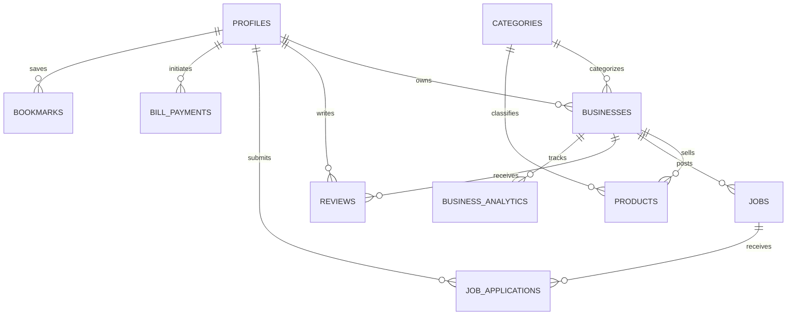

# Sadza Connect — System Architecture & Engineering Blueprint
**Version 1.0** | **Date:** September 2026  
**Client:** Africdominion Group (Pvt) Ltd (Gweru, Zimbabwe)  
**Lead Developer:** Ugwoke Levi  
**Tagline:** *Connecting People, Businesses and Opportunities*

---

## 1. Executive Summary & Design Vision

**Sadza Connect** is Zimbabwe's unified digital platform consolidating:
1. **Business Directory & Local Discovery** (Restaurants, Services, Healthcare, Agriculture, Hotels)
2. **Online Marketplace** (Products, Classifieds, Direct Seller WhatsApp Inquiries)
3. **Jobs Board & Career Opportunities** (Listings, Applications, Employer Management)
4. **Tourism, Travel & Events Guide** (Attractions, Lodging, Transport, Event Calendars)
5. **Bill Payments & Utilities** (Electricity tokens, Municipal Water, DSTV, Internet)

### 1.1 UI Reference & Heritage (The MATECH UI Foundation)
The user interface and design patterns directly leverage the high-performance, polished aesthetic of the **MATECH Integrated Services** template located in `Template/MATECHFULLPROJECTREPO`:
- **Card & Glassmorphism Design:** Subtle 1px borders, gentle card hover elevations, smooth rounded corners (`rounded-xl` and `rounded-2xl`).
- **Unified Admin Shell:** Collapsible desktop sidebar, fluid mobile drawer, sticky glassmorphic topbar with breadcrumb navigation, and tabbed manager panels.
- **Micro-Interactions & Transitions:** Powered by **Framer Motion** for smooth page reveals, modal drawers, and responsive state transitions.
- **Zimbabwean Identity Tokens:** Replacing industrial blues with Zimbabwe’s rich national colors—Savannah Emerald Green (`#007a3d`), Heritage Gold (`#eab308` / `#facc15`), Vibrant Red (`#d40000`), and Deep Obsidian Ink (`#090d16`)—crafted for WCAG 2.2 AA contrast compliance.

---

## 2. Technology Stack & Tooling

```
+-----------------------------------------------------------------------------------+
|                                  CLIENT LAYER                                     |
|  Responsive Web (Desktop: 1440px | Tablet: 768px | Mobile: 375px)                |
|  Next.js 14 App Router (React 18, TypeScript, Tailwind CSS, Lucide Icons)        |
+-----------------------------------------------------------------------------------+
                                         |
                                         v
+-----------------------------------------------------------------------------------+
|                             APPLICATION & SERVER LAYER                            |
|  - Server-Side Rendering (SSR) & Incremental Static Regeneration (ISR)            |
|  - Next.js Server Actions (Type-safe mutations, Zod validation)                   |
|  - Next.js Middleware (Session guarding, Role-Based Route Protection)             |
|  - Leaflet / OpenStreetMap Integration (Interactive maps, geo-markers)            |
|  - WhatsApp Deeplink Generator (Pre-formatted encoded context messages)           |
+-----------------------------------------------------------------------------------+
                                         |
                                         v
+-----------------------------------------------------------------------------------+
|                        PERSISTENCE & SECURITY (SUPABASE)                          |
|  - PostgreSQL 15+ Database (Relational data, Full-text search, Geo coords)        |
|  - Row-Level Security (RLS) Policies (Role enforcement at database level)        |
|  - Supabase Auth (Email/password, secure cookies via @supabase/ssr)               |
|  - Supabase Storage (Logos, verification docs, product gallery, CV uploads)       |
+-----------------------------------------------------------------------------------+
```

### Stack Breakdown
| Layer | Technology | Justification & Role in Project |
| :--- | :--- | :--- |
| **Framework** | **Next.js 14 (App Router)** | High-speed SSR/SSG for SEO, zero-bundle-size React Server Components, unified API via Server Actions. |
| **Language** | **TypeScript 5.5+** | End-to-end type safety across database entities, API actions, and UI component props. |
| **Styling** | **Tailwind CSS 3.4+** | Utility-first styling with custom design tokens matching the MATECH UI template and Zimbabwean identity. |
| **UI Primitives** | **Lucide React + Custom UI** | Lightweight SVG icons, accessible dialogs, dropdowns, and cards. |
| **Motion** | **Framer Motion 11** | Sleek transitions, animated accordions, mobile drawer navigation, and feedback toasts. |
| **Database** | **Supabase (PostgreSQL 15)** | ACID-compliant relational storage, jsonb support, search indexing, and automated backups. |
| **Authentication** | **Supabase Auth (`@supabase/ssr`)** | Secure HTTP-only cookies, SSR-compatible session recovery, multi-role management. |
| **Storage** | **Supabase Storage** | S3-compatible cloud storage for business logos, verification KYC docs, and product images. |
| **Mapping** | **Leaflet + OpenStreetMap** | Cost-effective, zero-API-billing map service for business locations and route directions. |
| **Validation** | **Zod 4.4+** | Schema validation for all input forms, registration workflows, and server actions. |
| **Charts** | **Recharts 2.12+** | Business analytics (page visits, WhatsApp clicks) and Admin platform metrics. |

---

## 3. UI/UX Design System & Color Palette

### 3.1 Zimbabwean Identity Palette (Tokens)
```css
/* Tailwind Color Palette Mappings */
:root {
  /* Zimbabwe Savannah Green (Primary Brand & Verification) */
  --color-green-50:  #f0fdf4;
  --color-green-500: #16a34a;
  --color-green-600: #007a3d; /* Zimbabwe Flag Green */
  --color-green-700: #005a2b;

  /* Heritage Gold (Accent, Ratings, Featured Badges) */
  --color-gold-50:   #fffbeb;
  --color-gold-400:  #facc15;
  --color-gold-500:  #eab308;
  --color-gold-600:  #c28800; /* Rich African Sun Gold */

  /* Opportunity Red / Coral (Alerts, Urgent CTA, Reporting) */
  --color-red-500:   #ef4444;
  --color-red-600:   #d40000; /* Zimbabwe Flag Red */

  /* Obsidian Ink (Backgrounds, Text, Slate Foundations) */
  --color-ink-50:    #f8fafc;
  --color-ink-100:   #f1f5f9;
  --color-ink-200:   #e2e8f0;
  --color-ink-700:   #334155;
  --color-ink-800:   #1e293b;
  --color-ink-900:   #0f172a;
  --color-ink-950:   #090d16; /* Deep Modern Midnight */
}
```

---

## 4. Database Schema Architecture (Supabase PostgreSQL)



### Key Tables & Entities
1. **`profiles`**: User accounts (Customer, Business Owner, Admin) linked 1:1 to Supabase Auth.
2. **`categories`**: Hierarchical categories (Restaurants, Healthcare, Education, Tourism, Agriculture, Services, Jobs, Marketplace).
3. **`businesses`**: Core business listing, location coordinates (lat/lng), opening hours, verification status, contact info, ratings.
4. **`products`**: Marketplace items with dual-pricing (USD & ZWL), image arrays, stock counts, and condition (new/used).
5. **`jobs` & `job_applications`**: Job listings, requirements, applicant submissions with resume attachments.
6. **`reviews` & `reports`**: Star ratings, moderation states, and abuse reporting.
7. **`bill_payments`**: Utility bill logs (ZESA prepaid tokens, municipal water, DSTV) in USD and ZWL.
8. **`business_analytics`**: Daily aggregated views and WhatsApp/call/direction conversion clicks.

---

## 5. Security & Row Level Security (RLS) Matrix

| Entity | Public / Guest | Customer | Business Owner | Platform Admin |
| :--- | :--- | :--- | :--- | :--- |
| **`profiles`** | Read public name/avatar | Read & Update own | Read & Update own | Full Access (CRUD) |
| **`categories`** | Read all | Read all | Read all | Full Access (CRUD) |
| **`businesses`** | Read `verified` businesses | Read `verified` | Create, Read, Update own | Full Access (Verify, Ban, Edit) |
| **`products`** | Read `is_active` | Read `is_active` | Manage own products | Full Access (Moderate, Delete) |
| **`jobs`** | Read `is_active` | Read & Submit app | Manage own job posts | Full Access |
| **`job_applications`** | None | Read own submissions | Read applications for own jobs | Full Access |
| **`reviews`** | Read approved reviews | Create review (1 per business) | Reply to reviews | Full Access (Moderate, Remove) |
| **`bill_payments`** | None | Read & create own | Read & create own | Full Access (Finance Audit) |
| **`reports`** | None | Create report | Create report | Full Access (Resolution) |

---

## 6. Core Integrations Architecture

### 6.1 WhatsApp Deep-Link Engine
To keep operating costs minimal while providing instant communication familiar to all Zimbabweans, all buyer-seller, applicant-employer, and platform interactions utilize direct WhatsApp click-to-chat links (`https://wa.me/<number>?text=<encoded_message>`).

### 6.2 OpenStreetMap & Leaflet Integration
- Cost: **100% Free** (No Google Maps API billing surprises).
- Interactive Map Component: Client-side dynamic rendering with custom SVG map pins denoting category types (Restaurants, Hotels, Services).
- Direct Directions Action: Generates OpenStreetMap routing URLs or device native map intents.

### 6.3 Dual-Currency Handling (USD & ZWL)
- Display everywhere with clear currency badges (`USD $15.00` / `ZWL 45,000`).
- Configurable platform exchange rate in system settings for automated rate approximations.

---

## 7. Project Directory Structure

```
sadza-connect/
├── public/
│   ├── brand/                 # Sadza Connect logos, icons, badges
│   ├── categories/            # Category vector icons
│   └── images/                # Zimbabwe hero images, tourism assets
├── src/
│   ├── app/                   # Next.js 14 App Router
│   │   ├── (public)/          # Public Portal Route Group
│   │   │   ├── page.tsx       # Homepage (Hero, Category Grid, Featured, Jobs)
│   │   │   ├── search/        # Global Search (List & OpenStreetMap view)
│   │   │   ├── businesses/    # Business Directory & [slug] Single Profile
│   │   │   ├── marketplace/   # Marketplace & [slug] Product Details
│   │   │   ├── jobs/          # Jobs Portal & [slug] Apply Modal
│   │   │   ├── bill-payments/ # Utility payments (ZESA tokens, DSTV, Water)
│   │   │   ├── tourism/       # Tourism attractions & travel guide
│   │   │   ├── events/        # Upcoming local events
│   │   │   ├── about/         # Company story & mission
│   │   │   ├── contact/       # Contact form & WhatsApp support
│   │   │   └── pricing/       # Business listing & advertising tiers
│   │   ├── (auth)/            # Authentication Group
│   │   │   ├── login/         # Sign in
│   │   │   ├── register/      # End-user registration
│   │   │   └── register-business/ # Multi-step business registration & KYC
│   │   ├── (portal)/          # Authenticated User & Business Portals
│   │   │   ├── dashboard/     # User personal dashboard (saved, orders, apps)
│   │   │   └── business/      # Business Owner Control Panel
│   │   │       ├── overview/  # Analytics, leads, page visits
│   │   │       ├── profile/   # Business details, gallery, hours editor
│   │   │       ├── products/  # Product catalog management
│   │   │       ├── jobs/      # Job postings & applicant tracker
│   │   │       └── reviews/   # Customer reviews & response tool
│   │   ├── admin/             # Platform Super Admin Portal
│   │   │   ├── layout.tsx     # AdminShell (Sidebar, topbar, auth guard)
│   │   │   ├── page.tsx       # Admin KPI dashboard
│   │   │   ├── businesses/    # Verification queue & business directory
│   │   │   ├── users/         # User role management
│   │   │   ├── marketplace/   # Product & listing moderation
│   │   │   ├── jobs/          # Job postings moderation
│   │   │   ├── bill-payments/ # Financial reconciliation & utility log
│   │   │   ├── reports/       # Trust & safety flagged content
│   │   │   └── settings/      # System parameters, exchange rates, CMS
│   │   ├── api/               # Webhooks & specialized server endpoints
│   │   ├── globals.css        # Tailwind directives & design tokens
│   │   └── layout.tsx         # Root layout (Inter + Space Grotesk fonts)
│   ├── components/
│   │   ├── ui/                # Core primitives (Button, Modal, Badge, Card, Field)
│   │   ├── layout/            # Navbar, MobileNav, Footer, SearchBar
│   │   ├── business/          # BusinessCard, BusinessGallery, HoursTable, MapView
│   │   ├── marketplace/       # ProductCard, PriceTag, WhatsAppBuyButton
│   │   ├── jobs/              # JobCard, ApplicationModal, ResumeUploader
│   │   ├── map/               # OpenStreetMapWrapper, LeafletMap, LocationPin
│   │   ├── portal/            # User & Business dashboard shells
│   │   └── admin/             # AdminShell, AdminTable, VerificationModal, KPIStat
│   ├── lib/
│   │   ├── auth/              # Supabase session, role guards, user profile
│   │   ├── supabase/          # client.ts, server.ts, admin.ts, middleware.ts
│   │   ├── actions/           # Server actions (businesses, products, jobs, bills)
│   │   ├── data/              # Default categories, Zimbabwe cities/provinces
│   │   ├── utils/             # WhatsApp link generator, currency formatters
│   │   └── types/             # Database and application TypeScript interfaces
│   └── middleware.ts          # Edge middleware for role-based route protection
├── supabase/
│   ├── migrations/            # Version-controlled SQL migration scripts
│   └── seed.sql               # Seed data (Zimbabwe categories, sample businesses)
├── tailwind.config.ts         # Zimbabwean color tokens & MATECH typography
└── package.json               # Next.js 14, Tailwind, Lucide, Leaflet, Supabase
```

---

## 8. Milestone Implementation & Delivery Roadmap

Aligned with the **$600 Software Development Agreement**:

### Milestone 1: Core Platform Architecture & MVP Launch ($270 — Paid)
- [x] Review & consolidation of PRD, UI/UX specs, and Development Agreement.
- [ ] Initialize project codebase with Next.js 14 App Router, TypeScript, and Tailwind CSS.
- [ ] Configure Supabase project, execute initial migrations (`profiles`, `categories`, `businesses`).
- [ ] Implement responsive public navigation (Navbar, Mobile Drawer, Footer) with Zimbabwean branding.
- [ ] Build interactive Homepage (Hero search, category grid, featured businesses).
- [ ] Implement Global Search & Filter system (Location, Category, Rating, List/Map view with OpenStreetMap).
- [ ] Build Business Profile Page (Photos gallery, operating hours, OpenStreetMap pin, direct WhatsApp click-to-chat).

### Milestone 2: Marketplace, Jobs, Bill Payments & Portals ($180 — Due on Delivery)
- [ ] Marketplace module (Browse products by category, product detail view, WhatsApp seller order link).
- [ ] Jobs board (Browse open positions, job details, multi-step job application modal with CV upload).
- [ ] Bill Payments module (Interface for ZESA electricity tokens, DSTV, municipal water in USD & ZWL).
- [ ] Business Onboarding & Verification flow (Registration form, logo & document upload).
- [ ] Personal User Dashboard (Saved businesses, applications submitted, past bill payments).
- [ ] Business Owner Control Panel (Analytics, product catalog management, review management).

### Milestone 3: Admin Suite, Moderation, QA & Handover ($150 — Due on Delivery)
- [ ] Super Admin Portal (Business verification approval queue, user management, flagged reports moderation).
- [ ] Trust & Safety features (Verified badge toggling, review management, audit logging).
- [ ] WCAG 2.2 AA accessibility audit, responsive testing (Desktop, Tablet, Mobile 375px).
- [ ] Deployment to production Vercel/Netlify hosting, custom domain configuration, and final handover.
