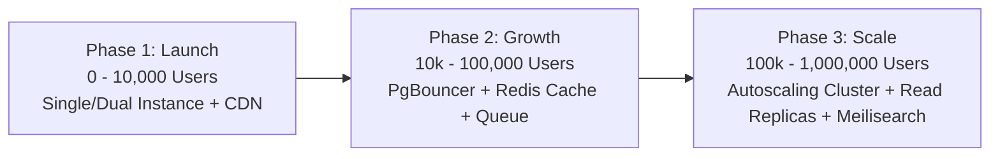

# Sadza Connect — 1 Million Users Architecture & Scaling Playbook

This document serves as the architectural reference and production roadmap for scaling **Sadza Connect Zimbabwe** to **1,000,000 users** seamlessly.

---

## 1. Executive Summary & Core Principle

**Can Next.js handle 1 million users?**  
**Yes, absolutely.** Next.js is battle-tested at multi-million user scales by organizations such as **TikTok, Hulu, Twitch, Nike, Notion, Loom, and Target**.

However, in modern full-stack systems:
> **The application framework (Next.js) will never be the bottleneck at 1 million users. The real bottlenecks are database connection pool saturation, unindexed queries, lack of Edge caching, and blocking I/O operations.**

---

## 2. Defining "1 Million Users"

To size infrastructure accurately, distinguish between three completely different load profiles:

| Metric | Definition | Load on the Server | Infrastructure Requirements |
| :--- | :--- | :--- | :--- |
| **1,000,000 Registered Users** | Total user accounts stored in PostgreSQL. | Minimal. A few hundred MB of disk space. | Standard PostgreSQL instance with B-Tree indexes on `email`, `phone`, and `id`. |
| **1,000,000 Monthly Active Users (MAU)** | ~30,000–50,000 Daily Active Users (DAU); ~1,000–3,000 peak concurrent users. | Moderate. ~50–200 requests/second. | 2–4 auto-scaled Node.js containers + Edge CDN caching. |
| **1,000,000 Concurrent Active Users** | 1,000,000 users actively sending requests at the exact same second. | Extreme enterprise scale (World Cup / Black Friday scale). | Multi-region distributed Kubernetes/ECS cluster, multi-AZ database read-replicas, and 95%+ CDN cache offload. |

---

## 3. Why the Unified Architecture Scales Well

The unified Next.js 14 codebase at the project root is already structured for horizontal scaling:

1. **Stateless JWT Authentication**
   - Sessions are verified using signed JWTs (`sadza_access_token`) validated on the server or Edge.
   - **Scale Advantage**: Zero sticky sessions and zero in-memory session lookups. Any container in the cluster can authenticate any user instantly without cross-server chatter.

2. **Lean Route Handlers (`src/app/api/v1/*`)**
   - Clean Architecture isolates Domain logic, Use Cases, and Repositories.
   - Route Handlers run as non-blocking asynchronous Node.js microservices inside the same runtime.

3. **Singleton Database Connection Pooling**
   - Database connections are cached via `globalThis.__sadza_db` and configured for Supabase/PgBouncer Transaction Pooling (port `6543`).
   - Prevents connection exhaustion and socket churn under heavy Next.js traffic.

4. **Next.js Edge Middleware Interception**
   - Sensitive routes (`/admin/:path*`) are protected at the Edge before heavier React page components or DB calls are executed.

---

## 4. The 5 Pillars Required for 1 Million Users

### Pillar 1: The 90/10 Read-to-Write Edge Caching Rule
In a platform like Sadza Connect:
- **90% of user traffic is Read-Only**: Browsing provincial directories, searching categories, viewing store profiles, reading job posts, and viewing marketplace listings.
- **10% is Write Traffic**: Account registration, document uploads, creating listings, and initiating bill payments.

**Action Plan:**
- Place a CDN like **Cloudflare** or **AWS CloudFront** in front of the Next.js application.
- Public read endpoints (Directory, Marketplace, Jobs) should leverage `Cache-Control: public, s-maxage=300, stale-while-revalidate=600`.
- **Result**: When 100,000 visitors browse the directory, **0 requests hit your PostgreSQL database**. The Edge CDN responds in `< 25ms`.

---

### Pillar 2: Database Connection Pooling (PgBouncer)
Direct PostgreSQL connections consume significant RAM (~5–10 MB per connection). A default PostgreSQL server chokes after 100–300 direct connections.

**Action Plan:**
- **Never connect Next.js directly to port 5432 in production.**
- Always route through **PgBouncer / Supabase Transaction Pooler (port 6543)**.
- Transaction pooling enables 5,000+ simultaneous web requests to share a compact, high-efficiency pool of 15–30 database connections.

---

### Pillar 3: Database Indexing & Query Optimization
At 1,000,000 accounts and 100,000 business listings, sequential table scans cause catastrophic database spikes.

**Mandatory Indexes:**
```sql
-- Fast user lookups for auth and login
CREATE INDEX IF NOT EXISTS idx_users_email ON users(email);
CREATE INDEX IF NOT EXISTS idx_users_phone ON users(phone_number);
CREATE INDEX IF NOT EXISTS idx_users_account_type ON users(account_type);

-- Directory queries by province & category
CREATE INDEX IF NOT EXISTS idx_businesses_province ON businesses(province);
CREATE INDEX IF NOT EXISTS idx_businesses_category ON businesses(category_id);
CREATE INDEX IF NOT EXISTS idx_businesses_status ON businesses(status);

-- Composite indexes for frequent directory filters
CREATE INDEX IF NOT EXISTS idx_businesses_prov_cat ON businesses(province, category_id) WHERE status = 'verified';

-- Full-Text Search across business names and descriptions
CREATE INDEX IF NOT EXISTS idx_businesses_fts ON businesses USING GIN(to_tsvector('english', name || ' ' || description));
```
With these indexes, searching across 1,000,000 records executes in **< 1 millisecond**.

---

### Pillar 4: Stateless Horizontal Auto-Scaling
Because the Next.js application maintains no local session state:

**Action Plan:**
- Deploy as a stateless Docker container (Render, AWS ECS Fargate, or GCP Cloud Run).
- Configure **CPU & Memory Autoscaling**:
  - **Baseline**: 2 instances (for high availability and zero-downtime rolling deploys).
  - **Scale Out**: Add 1 instance for every 70% average CPU threshold (up to 10–16 instances during peak national business hours).
  - **Scale In**: Scale back down to 2 instances during quiet night hours to minimize hosting cost.

---

### Pillar 5: Asynchronous Background Queues
Never execute blocking, heavy tasks in the HTTP request loop:
- **Email Dispatching**: Verification PINs, welcome emails, password resets (via Resend/SendGrid/SES).
- **ZESA & Utility Webhooks**: Transaction settlement notifications with aggregators.
- **Document Processing**: Compression and virus scanning of CR14 PDFs and owner National IDs.

**Action Plan:**
- Offload tasks to a background worker queue (**BullMQ + Redis**, AWS SQS, or Cloud Tasks).
- The HTTP request responds immediately (`202 Accepted`), and workers process the payload in the background.

---

## 5. Media & Search Infrastructure at Scale

### Business Document & Image Assets
- **Do not store images in PostgreSQL bytea columns.**
- Use **Cloudflare R2** or **AWS S3 / Supabase Storage** with a global CDN.
- Store only the immutable URL (`https://cdn.sadzaconnect.co.zw/storefronts/midlands-solar.webp`) in the database.
- Serve images in next-gen formats (`webp`/`avif`) with client responsive sizing (`next/image`).

### Search Engine Evolution
1. **Phase 1 (Up to 100k listings)**: PostgreSQL GIN Full-Text Search (zero additional hosting cost).
2. **Phase 2 (100k+ listings)**: Dedicated search engine (**Meilisearch**, **Typesense**, or **Algolia**) for typo tolerance ("solar invertor" -> "solar inverter") and sub-10ms response times.

---

## 6. Milestone-by-Milestone Growth Roadmap



| Scale Milestone | Architecture Blueprint | Target Monthly Cost |
| :--- | :--- | :--- |
| **Stage 1: Launch (0 – 10,000 Users)** | 1–2 Render/VPS web instances, Supabase managed DB, Cloudflare Free CDN, local Knex pool. | **$25 – $50/mo** |
| **Stage 2: Growth (10,000 – 100,000 Users)** | 2–4 auto-scaled instances, PgBouncer transaction pooling (port 6543), Redis for rate-limiting, Cloudflare Pro. | **$100 – $250/mo** |
| **Stage 3: National Scale (100,000 – 1,000,000 Users)** | Auto-scaling container cluster (AWS ECS/Render), PostgreSQL Primary (Writes) + Read-Replica (Reads), Cloudflare R2 media storage, BullMQ workers. | **$350 – $800/mo** |

---

## 7. Operational Health Checklist (Production SLA)

Before launching high-traffic marketing campaigns, verify:

- [ ] **PgBouncer Port Active**: Production `.env` uses port `6543` for database pooling.
- [ ] **Database Indexes Applied**: Run `EXPLAIN ANALYZE` on directory and login queries; verify `Index Scan` rather than `Seq Scan`.
- [ ] **Edge Caching Configured**: Public pages return `cf-cache-status: HIT` on repeat visits.
- [ ] **Rate Limiting Active**: In-memory or Redis rate limiter blocks brute-force login attempts (default: 100 req / 15 min).
- [ ] **Error Tracking**: Sentry / Pino logging active with structured JSON output for immediate incident alert notifications.
- [ ] **Target Latency SLA**:
  - Public cached pages: **< 50ms**
  - Authenticated API routes: **< 150ms**
  - Database queries: **< 15ms**
